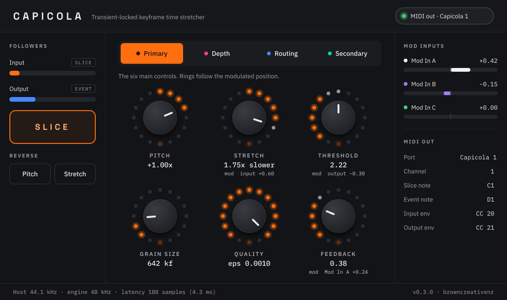

# Granular-plugin

Copyright (C) 2026 browncreativenz

This program is free software: you can redistribute it and/or modify it under
the terms of the GNU Affero General Public License as published by the Free
Software Foundation, either version 3 of the License, or (at your option) any
later version. See [LICENSE](LICENSE).

The AGPL-3.0 matches the license of the
[Capicola](https://github.com/heavylight-industries/capicola) firmware, whose
DSP core this plugin builds on.

## Status

Milestones M0 and M1 of [the plan](docs/PLAN.md) are done:

- Capicola's audio engine runs on a desktop and matches the firmware sample for
  sample.
- It works at any host sample rate: the engine always runs at 48 kHz, as the
  hardware does, with high-quality resampling around it at other rates.
- All parameters use the firmware's knob curves and factory defaults, and each
  primary control has the module's modulation routing.

All four milestones are done and tested in Ableton Live: the JUCE plugin (VST3,
AU, Standalone), the module's trigger and envelope outputs as MIDI, Pitch and
Stretch Reverse, and the plugin window below, designed from an interactive
mockup.



## Build

Requires CMake 3.22 or later and a C++17 compiler (Xcode's command-line tools
on macOS).

```sh
git submodule update --init external/capicola   # first checkout only; no --recursive needed
cmake -B build -DCMAKE_BUILD_TYPE=Release        # fetches JUCE 8.0.15 the first time
cmake --build build --parallel
ctest --test-dir build
```

The tests run the firmware's own DSP test suite, compare this port's engine with
the firmware's `audio_engine.cpp` bit for bit (`tests/engine_golden.cpp`), check
the knob curves against the firmware's, and measure the resampler at every
sample rate Live offers.

The build installs the plugin for your user: on macOS the VST3 into
`~/Library/Audio/Plug-Ins/VST3` and the AU into
`~/Library/Audio/Plug-Ins/Components`. The Standalone app is in
`build/plugin/Capicola_artefacts/Release/Standalone`.

- To use a JUCE checkout you already have, add
  `-DFETCHCONTENT_SOURCE_DIR_JUCE=/path/to/JUCE`.
- To build only the engine, renderer and tests, without JUCE, add
  `-DGRANULAR_BUILD_PLUGIN=OFF`.

Or skip building: every push runs the **Build** workflow on GitHub Actions,
and its run page has a `Capicola-macOS` download with the VST3, AU and
Standalone app. Those are signed ad hoc, so after unzipping, clear the
quarantine flag before Live will load them:

```sh
xattr -dr com.apple.quarantine Capicola.vst3   # likewise Capicola.component, Capicola.app
```

## Using it in Ableton Live

After installing, rescan plug-ins (Settings > Plug-Ins > Rescan). Capicola is
under Plug-Ins, by browncreativenz, as a VST3 and an AU.

**The window** (open it with the plug-in window button on the device) follows the
module's panel:

- **Pages:** Primary, Depth, Routing and Secondary, in the module's colours.
  The six knobs change with the page. Drag up or down to turn one;
  double-click to reset it.
- **Rings:** each ring lights up to the knob's position. On Primary it follows
  the *modulated* position, with the difference from the knob shown in dim
  white and the source and depth written underneath. On Routing, the five
  coloured segments are the five modulation sources, with the chosen one lit.
  The LED at the bottom of every ring shows the input follower.
- **Left:** the input and output followers, with lamps that flash on each slice
  and each output event; the Slice button; Pitch and Stretch Reverse.
- **Right:** Mod In A–C and the MIDI out settings. The chip at the top right
  switches MIDI out and shows the port's name.

- **Parameters** are the module's knobs as 0–100% positions; each readout
  shows what the position means (+1.00x, 1.75x slower, Freeze, 20.0 ms).
- **Slice:** the Slice parameter slices each time it turns on; map it to a
  button with MIDI Map (Cmd-M). Any MIDI note-on also slices: on a MIDI track,
  set MIDI To to the track holding Capicola, then choose Capicola.
- **Mod In A–C** stand in for the module's CV inputs; drive them with clip
  envelopes or Max for Live LFOs, and route them with the Mod Source and Depth
  parameters.
- **Pitch Reverse / Stretch Reverse** flip direction at the same speed, like
  the module's hold-Slice-and-nudge gesture. Map them to buttons for
  performance.
- Latency is reported to Live, which compensates for it: 1.3 ms at 48 kHz,
  about 4 ms at 44.1 or 96 kHz.

### Trigger and envelope outputs (MIDI)

The module's TRIG and ENV jacks come out as MIDI on a port the plugin creates,
**Capicola 1** (a second instance makes Capicola 2, and so on), because Live
doesn't route MIDI out of audio effects.

| Module output | MIDI | Default |
|---|---|---|
| Every slice (detected or manual) | 10 ms note | C1 (36), the first Drum Rack pad |
| Output-follower transient | 10 ms note | D1 (38) |
| Input envelope | controller, up to 100 values a second | CC 20 |
| Output envelope | controller | CC 21 |

Channel, notes and CC numbers are plugin parameters (MIDI Channel, Slice Note,
Output Event Note, Input/Output Envelope CC). **MIDI Out** switches it off.

1. In **Settings > Link, Tempo & MIDI**, find **Capicola 1** under Input Ports
   and turn on **Track** (for the notes) and **Remote** (for MIDI-mapping the
   envelopes). If it isn't listed, close and reopen Settings, or restart Live.
2. **Notes:** on a MIDI track with a Drum Rack, set **MIDI From** to
   Capicola 1 and **Monitor** to **In**.
3. **Envelopes:** press Cmd-M, click any control in Live, and play some audio
   through Capicola: the envelope CC maps to it.

Don't route the Capicola port back into Capicola itself: every note-on slices,
so its own slice notes would keep re-slicing it.

The notes leave at the audio's timing, but through a MIDI port rather than
Live's audio graph, so they arrive a buffer or so early relative to what you
hear. If that matters, delay the receiving track with its **Track Delay**.

## Render audio from the command line

```sh
./build/capicola_render out.wav                       # built-in drums-and-pad test signal
./build/capicola_render --in loop.wav --set stretch=0.6 --set pitch=0.25 out.wav
./build/capicola_render --list                        # every parameter and its default
```

Parameters are knob positions from 0 to 1, as on the module and in the plugin:
`pitch=0.25` is −1x (reverse), `stretch=0.5` freezes. Input can be any sample
rate.

## Layout

- `external/capicola/` — the Capicola firmware (v1.1.0), as a git submodule.
  Only its `lib/` DSP headers are compiled into the engine.
- `core/` — `CapicolaEngine`, the firmware's audio engine ported off the Daisy;
  `CapicolaProcessor`, which adds sample-rate conversion, the parameters and
  modulation, and is what the plugin uses.
- `plugin/` — the JUCE plugin.
- `tools/render/` — the command-line renderer.
- `tests/` — engine tests, plus stubs that let the firmware engine build on a
  desktop for comparison.
- `docs/PLAN.md` — the build plan and milestones.
